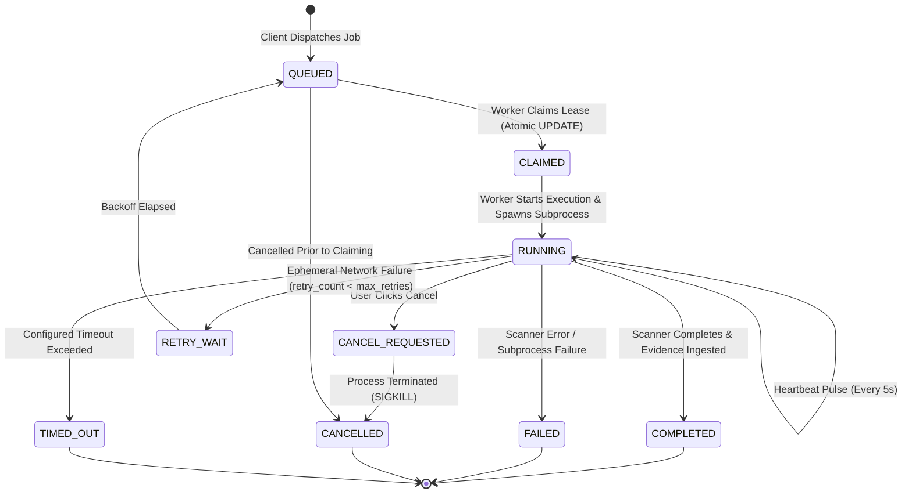

# FOOTPRINTIQ — TASK 02 DURABLE JOB EXECUTION & RESTART RECOVERY ARCHITECTURE REPORT

**Document Reference:** `docs/FOOTPRINTIQ_TASK_02_DURABLE_JOB_EXECUTION_REPORT.md`  
**Phase:** Phase 3 (Task 02)  
**Execution Date:** 2026-11-02 (Local System Time: Asia/Calcutta)  
**Author / Lead Architect:** Antigravity (Google DeepMind)  
**Status:** **ARCHITECTURE & IMPLEMENTATION PLAN COMPLETE — AWAITING IMPLEMENTATION APPROVAL (GATE 3)**

---

## 1. Executive Summary & Problem Statement

### 1.1 The Ephemeral Execution Problem
FootprintIQ currently launches Nmap and Greenbone scans using in-process Python tasks via `asyncio.create_task()`:
- `app/api/nmap_scans.py:114`: `asyncio.create_task(runner.execute_scan(...))`
- `app/api/vulnerability.py:130`: `asyncio.create_task(...)`
- `app/api/recon.py:60`: Runs synchronously within the HTTP request handler (`await orchestrator.run(...)`).

### 1.2 Identified Failure Modes
1. **Orphaned Jobs on Reboot:** If the application terminates or restarts while an Nmap scan is executing, the database row remains frozen in `RUNNING` or `QUEUED` indefinitely. No supervisor restarts, retries, or marks the job failed.
2. **Untracked OS Subprocesses:** `NmapRunner` stores subprocess handles in an in-memory dictionary `self._active_processes[job_id]`. If the server restarts, the operating system subprocess continues running detached, while the server loses the ability to monitor, cancel, or harvest its output.
3. **In-Memory Cancellation State:** Cancellation requests are stored in `self._cancellation_requests[job_id]`. Cancellation cannot be distributed across workers or survive a restart.
4. **Lack of Concurrency Leasing:** No durable lease exists; multiple worker processes or restarts could attempt to execute the same scan simultaneously.

---

## 2. Durable Job Execution Architecture

### 2.1 The Unified `jobs` Persistence Model
To ensure complete continuity with existing database records, a dedicated `jobs` table will be introduced via `JobModel` (`app/models/job.py`). This table acts as the unified supervisor queue for all asynchronous tasks across the platform:

```python
class JobModel(Base):
    __tablename__ = "jobs"

    id: Mapped[str] = mapped_column(String(64), primary_key=True, index=True)
    investigation_id: Mapped[str] = mapped_column(
        String(64), ForeignKey("investigations.id", ondelete="CASCADE"), nullable=False, index=True
    )
    job_type: Mapped[str] = mapped_column(String(32), nullable=False, index=True)  # NMAP_SCAN, VULN_SCAN, PASSIVE_RECON
    operation: Mapped[str] = mapped_column(String(64), nullable=False)            # SCAN_ACTIVE, SCAN_VULN, RECON_PASSIVE
    target: Mapped[str] = mapped_column(String(255), nullable=False, index=True)
    parameters: Mapped[Dict[str, Any]] = mapped_column(JSON, default=dict, nullable=False) # Sanitized; zero secrets
    status: Mapped[str] = mapped_column(String(32), default="QUEUED", nullable=False, index=True)
    progress: Mapped[int] = mapped_column(Integer, default=0, nullable=False)
    
    # Ownership & Concurrency Leasing
    requested_by: Mapped[str] = mapped_column(String(64), nullable=False, index=True)
    worker_id: Mapped[Optional[str]] = mapped_column(String(64), nullable=True, index=True)
    process_pid: Mapped[Optional[int]] = mapped_column(Integer, nullable=True) # OS Subprocess PID
    lease_expires_at: Mapped[Optional[datetime]] = mapped_column(DateTime(timezone=True), nullable=True, index=True)
    heartbeat_at: Mapped[Optional[datetime]] = mapped_column(DateTime(timezone=True), nullable=True)
    
    # Retry & Failure Handling
    retry_count: Mapped[int] = mapped_column(Integer, default=0, nullable=False)
    max_retries: Mapped[int] = mapped_column(Integer, default=1, nullable=False)
    error_category: Mapped[Optional[str]] = mapped_column(String(64), nullable=True)
    error_message: Mapped[Optional[str]] = mapped_column(Text, nullable=True)
    
    # Cancellation Controls
    cancellation_requested: Mapped[bool] = mapped_column(Boolean, default=False, nullable=False)
    cancellation_reason: Mapped[Optional[str]] = mapped_column(Text, nullable=True)
    
    # Timestamps & Associated Evidence
    evidence_id: Mapped[Optional[str]] = mapped_column(
        String(64), ForeignKey("evidence.id", ondelete="SET NULL"), nullable=True, index=True
    )
    created_at: Mapped[datetime] = mapped_column(DateTime(timezone=True), default=utc_now, nullable=False)
    started_at: Mapped[Optional[datetime]] = mapped_column(DateTime(timezone=True), nullable=True)
    completed_at: Mapped[Optional[datetime]] = mapped_column(DateTime(timezone=True), nullable=True)
    updated_at: Mapped[datetime] = mapped_column(DateTime(timezone=True), default=utc_now, onupdate=utc_now, nullable=False)
```

### 2.2 Continuity with Specialized Models
The existing tables (`active_scan_jobs`, `vuln_scan_jobs`, and `collection_jobs`) will be preserved without breaking relational joins:
- When an active scan is created, both a `JobModel` record and an `ActiveScanJobModel` record are created with identical `id`.
- The specialized models continue to store specialized foreign keys (`hosts`, `ports`, `findings`), while the `JobModel` manages queueing, leases, heartbeats, retries, and worker recovery.

---

## 3. Explicit Job Lifecycle State Machine



### Valid State Transitions
1. `QUEUED` -> `CLAIMED`, `CANCELLED`
2. `CLAIMED` -> `RUNNING`, `FAILED`, `CANCELLED`
3. `RUNNING` -> `COMPLETED`, `FAILED`, `CANCEL_REQUESTED`, `TIMED_OUT`, `RETRY_WAIT`
4. `CANCEL_REQUESTED` -> `CANCELLED`, `FAILED`
5. `RETRY_WAIT` -> `QUEUED`, `CANCELLED`
6. Terminal States: `COMPLETED`, `FAILED`, `CANCELLED`, `TIMED_OUT` (no transitions permitted).

---

## 4. Worker Concurrency & Atomic Claiming Strategy

### 4.1 Cross-Dialect Atomic Claiming (SQLite + SQL Server 2022)
To eliminate race conditions between concurrent worker threads without relying on dialect-specific syntax (such as PostgreSQL's `FOR UPDATE SKIP LOCKED` or SQL Server's `WITH (UPDLOCK, READPAST)`), an optimistic conditional atomic update is used:

```python
def claim_next_job(db: Session, worker_id: str, supported_types: List[str]) -> Optional[JobModel]:
    """Atomically claims the oldest pending QUEUED job using conditional update."""
    now = utc_now()
    lease_until = now + timedelta(seconds=60)
    
    # 1. Find candidate eligible job ID
    stmt = (
        select(JobModel.id)
        .where(
            JobModel.status == "QUEUED",
            JobModel.job_type.in_(supported_types),
            JobModel.cancellation_requested == False,
        )
        .order_by(JobModel.created_at.asc())
        .limit(1)
    )
    candidate_id = db.scalars(stmt).first()
    if not candidate_id:
        return None
        
    # 2. Atomic claim update
    rows_affected = db.execute(
        update(JobModel)
        .where(
            JobModel.id == candidate_id,
            JobModel.status == "QUEUED"  # Concurrency guard
        )
        .values(
            status="CLAIMED",
            worker_id=worker_id,
            lease_expires_at=lease_until,
            heartbeat_at=now,
            updated_at=now,
        )
    ).rowcount
    
    if rows_affected == 1:
        db.commit()
        return db.get(JobModel, candidate_id)
    
    db.rollback()
    return None  # Lost race to another worker
```

### 4.2 Heartbeat & Lease Management
- While executing, the worker maintains an asynchronous background task sending heartbeats every 5 seconds:
  `UPDATE jobs SET heartbeat_at = :now, lease_expires_at = :now + 60s WHERE id = :job_id AND status = 'RUNNING'`.
- If a worker crashes, its lease expires within 60 seconds.

---

## 5. Startup Restart Recovery Workflow

On application startup (integrated into `app/main.py:lifespan`):
1. **Scan Stale Leases:** Query `jobs` where `status IN ('CLAIMED', 'RUNNING')`.
2. **Subprocess Verification:** If `process_pid` is present, check whether that OS PID is running on the host:
   - If running and command line indicates an orphaned Nmap scan: terminate process safely (`psutil.Process(pid).kill()`).
3. **Stale Job Reconciliation:**
   - Active scans (Nmap) and vulnerability scans (Greenbone) are non-idempotent network scans; automatic rerun without user consent is unsafe.
   - Transition stale jobs to `FAILED` with:
     - `error_category = "SERVER_RESTARTED"`
     - `error_message = "Scan job was interrupted by server shutdown/crash; lease recovered on restart."`
     - `completed_at = now()`
   - Synchronize corresponding records in `active_scan_jobs` or `vuln_scan_jobs`.
4. **Audit Event Logged:** Emit `JOB_RECOVERY_RECONCILED` audit log entry with full details.

---

## 6. Durable Cancellation Workflow

When `/api/v1/nmap-scans/{id}/cancel` or `/api/v1/vulnerability-assessments/{id}/cancel` is invoked:
1. **Database Flag Set:** Set `cancellation_requested = True`, `cancellation_reason = reason` in `jobs`.
2. **Immediate State Transition:**
   - If job is `QUEUED`: transition immediately to `CANCELLED`.
   - If job is `RUNNING`: transition to `CANCEL_REQUESTED`.
3. **Worker Signal:**
   - The worker monitoring the subprocess catches the cancellation flag during its heartbeat loop or signal handler.
   - For Nmap subprocesses: worker calls `process.kill()` and awaits termination.
   - For Greenbone scans: worker sends `stop_task` command to GVM daemon.
   - Final status updated to `CANCELLED`.

---

## 7. Frontend Integration & HTMX Polling

The investigation detail page (`app/templates/investigation_detail.html` and `web_dashboard.py`):
1. Replaces browser-local memory polling with a unified HTMX polling fragment:
   `<div hx-get="/partials/investigations/{id}/jobs" hx-trigger="every 3s" hx-swap="outerHTML">`.
2. Renders real-time persisted status for every job:
   - Status badge (`QUEUED` [yellow], `RUNNING` [blue], `COMPLETED` [green], `FAILED` [red], `CANCELLED` [gray]).
   - Progress bar (0% to 100%).
   - Worker ID, duration counter, and retry count.
   - Interactive `Cancel` button for active jobs.

---

## 8. Implementation Plan & Affected Modules

| Module / File | Change Scope |
|---|---|
| `app/models/job.py` | **NEW FILE:** `JobModel` unified queue schema. |
| `app/models/__init__.py` | Export `JobModel`. |
| `app/services/jobs/queue.py` | **NEW FILE:** `JobQueueService` (enqueue, atomic claim, heartbeat, complete, fail). |
| `app/services/jobs/recovery.py` | **NEW FILE:** `JobRecoveryService` (startup scan, lease expiration, orphaned process termination). |
| `app/services/jobs/worker.py` | **NEW FILE:** `DurableJobWorker` (async worker loop, concurrency semaphores, graceful shutdown). |
| `app/services/active/runner.py` | Integrate with `JobModel`: store OS PID, update heartbeats/progress, check durable cancellation. |
| `app/services/vuln/orchestrator.py` | Integrate with `JobModel`: update progress from GVM, check durable cancellation flag. |
| `app/main.py` | Register `JobRecoveryService` and `DurableJobWorker` startup/shutdown in `lifespan`. |
| `app/api/web_dashboard.py` | Add HTMX partial for real-time persisted job queue rendering. |
| `app/templates/investigation_detail.html` | Include live job queue status component. |
| `migrations/versions/0008_durable_jobs.py` | **NEW MIGRATION:** Create `jobs` table with appropriate indexes. |
| `tests/test_durable_jobs.py` | **NEW TEST SUITE:** Comprehensive regression coverage for queue, leases, claims, recovery, cancellation, and concurrency. |

---

## 9. Comprehensive Testing Strategy

A dedicated test suite `tests/test_durable_jobs.py` will verify:
1. **Job Enqueue & Metadata:** Jobs created with sanitized parameters, initial `QUEUED` state, zero secrets.
2. **Atomic Worker Claiming:** Two simulated worker loops claiming concurrently; assert zero double-claims.
3. **Heartbeat & Lease Expiration:** Simulated worker failure after 1 heartbeat; assert lease expires and job is identified as stale.
4. **Restart Recovery:** Seed running jobs with expired leases; execute `JobRecoveryService.recover_stale_jobs()`; verify transition to `FAILED` with `SERVER_RESTARTED` category.
5. **Durable Cancellation:** Cancel job in `QUEUED` state (immediate cancel); cancel job in `RUNNING` state (assert subprocess termination and status `CANCELLED`).
6. **Graceful Shutdown:** Worker finishes active work or releases lease cleanly on SIGTERM/FastAPI shutdown.
7. **Security Isolation:** Cross-investigation and unauthorized user cancellation rejected with 403.

---

## 10. Gate 3 Approval Request

This design satisfies all requirements of Section 7:
- Database-backed persistence.
- Explicit 9-state lifecycle.
- Dialect-agnostic atomic claiming.
- Safe restart recovery without disruptive re-scans.
- Subprocess PID-aware durable cancellation.
- Real-time HTMX frontend queue visualization.

I request your authorization to proceed with implementing Phase 3 (Task 02) per this architecture plan.

