# FOOTPRINTIQ — MASTER PROJECT BASELINE REPORT (PHASE 0)

**Document Reference:** `docs/MASTER_PROJECT_BASELINE_REPORT.md`  
**Execution Date:** 2026-11-02 (Local System Time: Asia/Calcutta)  
**Author / Lead Architect:** Antigravity (Google DeepMind)  
**Predecessor AI Developer:** OpenAI Codex  
**Repository:** `https://github.com/asipali/FootPrintQ_v2`  
**Branch:** `migration/python-only`  
**Baseline HEAD Commit:** `f484b09 fix modules` (Committed: 2026-11-02 13:40:25 +0530)

---

## 1. Executive Summary & Project Baseline

FootprintIQ is an active and passive cybersecurity investigation and digital footprint reconnaissance platform. The application is transitioning from a legacy hybrid Node.js/React prototype into a unified, high-performance **Python 3.11+ / FastAPI / SQLAlchemy / Jinja2 + HTMX** architecture on the `migration/python-only` branch.

### Current Operating State:
- The core web application and REST API run under Python 3.11 with FastAPI.
- Persistence is currently managed via a local SQLite database (`footprintiq.db`) configured for Write-Ahead Logging (WAL).
- Forensic evidence is stored as raw filesystem artifacts under `./evidence_storage`.
- External scanning tools (Nmap, Greenbone OpenVAS) and passive OSINT collectors (DNS, RDAP, CRT.sh, theHarvester) have dedicated execution and parsing services.
- A comprehensive 16-module engineering audit (Task 00) was completed and documented.
- Security hardening (Task 01) covering CSRF enforcement across mutation routes and test environment isolation was implemented by Codex, but remains uncommitted due to a tracked binary SQLite sidecar modification (`footprintiq.db-shm`).
- Handover from OpenAI Codex to Antigravity has been formally executed and verified.

---

## 2. Git and Working Tree Baseline

### 2.1 Git Repository Identifiers
- **Workspace Root:** `D:\Desktop\HackShift\footprint`
- **Current Branch:** `migration/python-only`
- **Upstream Remote:** `origin/migration/python-only` (up to date with remote HEAD)
- **HEAD Commit:** `f484b0945fc7534b190d1a32ec53d5b5d9742ee2` (`fix modules`)
- **Staged Changes (`git diff --cached`):** `0` files (Clean index)

### 2.2 Working Tree Modifications (Unstaged)
The following 10 tracked files carry local modifications from Task 01:

| File Path | Status | Impact / Description |
|---|---|---|
| `app/api/deps.py` | Modified | Hardens `verify_csrf_token` to validate that `Authorization: Bearer <token>` resolves to an active, unexpired, unrevoked server session in `user_sessions` and that the account is active/unlocked. |
| `app/api/nmap_scans.py` | Modified | Attaches `Depends(verify_csrf_token)` to `dispatch_nmap_scan` (POST) and `cancel_scan_job` (POST). |
| `app/api/recon.py` | Modified | Attaches `verify_csrf_token` to `trigger_passive_recon` (POST) and `validate_target` (POST). |
| `app/api/users.py` | Modified | Attaches `verify_csrf_token` to user provisioning (`POST /api/v1/users`), role modification (`PATCH .../role`), and status modification (`PATCH .../status`). |
| `app/api/vulnerability.py` | Modified | Attaches `verify_csrf_token` to `dispatch_vulnerability_assessment` (POST) and `cancel_vulnerability_assessment` (POST). |
| `app/models/__init__.py` | Modified (Stat) | File stat/mtime update; semantic content is identical to HEAD. |
| `footprintiq.db-shm` | Modified (Binary) | Binary SQLite shared-memory index modified when tests touched the real database before startup probe isolation was implemented. |
| `tests/conftest.py` | Modified | Adds `isolated_evidence_storage` autouse fixture routing implicit `EvidenceStore` writes to `tmp_path`; monkeypatches `app.main.check_database_connection` to route startup probes to `test_engine`. |
| `tests/test_csrf_and_cookies.py` | Modified | Adds safe GET cookie-session CSRF exemption regression test. |
| `tests/test_evidence_storage.py` | Modified | Adds implicit-store isolation assertion and tampered-content hash detection test. |

### 2.3 Untracked Files in Workspace
| File Path | Purpose / Origin |
|---|---|
| `tests/test_mutation_csrf.py` | New test suite with 8 regression tests verifying CSRF enforcement across mutation endpoints, Bearer validation, and zero side-effect mutations. |
| `docs/FOOTPRINTIQ_TASK_01_SECURITY_HARDENING_REPORT.md` | Codex implementation report for Task 01. |
| `docs/FOOTPRINTIQ_CODEX_TO_ANTIGRAVITY_HANDOVER_REPORT.md` | Handover audit report detailing Codex stopping point and repository status. |
| `docs/FOOTPRINTIQ_MASTER_PROGRESS_TRACKER.md` | Master phase and gate tracking dashboard. |
| `docs/MASTER_PROJECT_BASELINE_REPORT.md` | This document (Phase 0 baseline). |

---

## 3. Database Physical State & Integrity Analysis

### 3.1 SQLite File Inventory
Physical inspection of the database files in the repository root confirms the following:

| File Name | Size (Bytes) | Last Modified | Git Status | SHA-256 Digest |
|---|---|---|---|---|
| `footprintiq.db` | 516,096 | 2026-11-02 11:18 | Ignored (`*.db`) | `8A76DE892695600F09CDBC6627A381279134B63FF393BA4D94789E9C3F7D4F57` |
| `footprintiq.db-wal` | 3,666,832 | 2026-11-02 14:54 | Ignored (`*.db-wal`) | `089871B42AB9B84058D884B3577A7BA543758B2309ADFA036960E661ED301232` |
| `footprintiq.db-shm` | 32,768 | 2026-11-02 17:56 | Tracked (Modified) | `28BF8315C97B5A74E4B1AE61DC44F54B94AAF9034A9C37CFC08DC124D12D77C9` |
| `footprintiq.db.backup` | 466,944 | 2026-10-28 03:06 | Tracked | `B11B4F58EB092DF7F3C8CDCC0DDEC4E0B9672C3358C66C093DBC78E75421F0D6` |
| `footprintiq.db.backup-shm` | 32,768 | 2026-11-02 13:12 | Tracked | `FD4C9FDA9CD3F9AE7C962B0DDF37232294D55580E1AA165AA06129B8549389EB` |
| `footprintiq.db.backup-wal` | 0 | 2026-11-02 13:11 | Tracked | `E3B0C44298FC1C149AFBF4C8996FB92427AE41E4649B934CA495991B7852B855` |

### 3.2 Critical WAL & Sidecar Risk
1. **Asymmetric Tracking:** In `.gitignore`, `*.db` and `*.db-wal` are properly excluded, but `*.db-shm` and `*.db.backup*` are missing. Consequently, Git tracks `footprintiq.db-shm`.
2. **Uncheckpointed Data:** The WAL file is **3.66 MB**, holding dozens of active transactions. The `-shm` file is SQLite's dynamic index into those WAL frames. Reverting `footprintiq.db-shm` via `git checkout` would desynchronize the index from the WAL log and risk index corruption (`SQLITE_CORRUPT`).
3. **Active Connection Check:** Process inspection confirmed zero running `python`, `uvicorn`, `nmap`, or `gvm` processes. The database is in an unlocked, quiescent state.

---

## 4. Evidence Storage Baseline

- **Location:** `./evidence_storage`
- **Total Files:** 264 forensic files (DNS resolution logs, RDAP lookups, CRT.sh certificates, Nmap raw outputs, and Greenbone OpenVAS XML reports).
- **Git Tracking:** All 264 files are tracked in Git under commit `f484b09`.
- **Integrity:** `git diff evidence_storage` reports zero modifications. The directory is 100% clean and matches repository HEAD.
- **Foreign Key Association:** These files are referenced by UUID in `evidence.id` records in the database.

---

## 5. Environment & Infrastructure Baseline

| Component | Status | Details |
|---|---|---|
| **Python Runtime** | Available | Python 3.11.9 (`C:\Users\asipa\AppData\Local\Programs\Python\Python311\python.exe`). |
| **Package Management** | Editable Mode | `footprintiq 2.0.0` installed in editable mode (`pyproject.toml`). No dependency lockfile exists. |
| **Nmap Executable** | Installed | Auto-discovered on PATH: `E:\asipali\nmap.exe` (Version 0.0.0.0). |
| **Greenbone GVM CLI** | Not Configured | No `gvm-cli` binary or Unix socket found in environment. GMP operations mock-tested. |
| **theHarvester** | Not Configured | No executable on PATH. Collector returns disabled/mock status. |
| **SQL Server 2022 Express** | Target Infrastructure | Target destination for Phase 4. `pyodbc` / `pymssql` drivers are not currently installed in Python 3.11 environment. |
| **SeaweedFS** | Target Infrastructure | Target destination for Phase 5. No S3 client (`boto3`) or Filer adapter currently installed. |
| **Docker Configuration** | Present | `Dockerfile` exists (Python 3.11 slim, Nmap, unprivileged user). No `docker-compose.yml` present. |

---

## 6. Completed vs. Incomplete Functionality Inventory

### 6.1 Completed Functionality
- **Authentication & RBAC:** Argon2id password hashing, server-side hashed session tokens, role permissions (`ROLE_INVESTIGATOR`, `ROLE_ADMINISTRATOR`), temporary account lockout, audit event logging.
- **Investigation Lifecycle:** Investigation creation, multi-investigator assignment, status management, scope configuration, and authorization controls.
- **Target Authorization:** Strict domain/IP allowlist scoping, signed target authorization models, execution-time revalidation before active scans.
- **Passive OSINT:** Deduplicated asynchronous collectors for DNS (A, AAAA, MX, NS, TXT), RDAP registration details, and Certificate Transparency (crt.sh).
- **Scanner Execution:** Nmap runner with argument vetting and XML parsing; Greenbone GMP protocol adapter and OpenVAS report parsing.
- **Reporting & Visualization:** ReportLab PDF investigation dossier generation, GraphML attack-surface topology exports, HTMX live dashboard widgets.
- **Task 01 Hardening:** REST mutation CSRF protection, Bearer session validation, and test isolation fixtures.

### 6.2 Incomplete Functionality
- **Durable Job Engine (Task 02 / Phase 3):** All scans currently execute via in-memory `asyncio.create_task()`. Server restarts orphan running scans. No heartbeat, lease claiming, or retry queue exists.
- **SQL Server 2022 Express (Task 03 / Phase 4):** Database layer is SQLite-only. Alembic migrations use SQLite `batch_alter_table`. No SQL Server connection or migration tooling exists.
- **SeaweedFS Object Storage (Task 04 / Phase 5):** Evidence store is bound to local filesystem paths (`Path.write_bytes`). No provider-neutral storage interface exists.
- **Unified Pipeline Orchestration (Phase 6):** Recon, Nmap, and Greenbone are disparate modules without a coordinated multi-stage pipeline state machine.
- **Calibrated Exposure Scoring (Phase 7):** Current 5-factor scoring is heuristic and lacks coverage calibration.
- **Disaster Recovery (Phase 9):** No automated dual-backup/restore process covering both metadata and object storage.
- **Production Lockfile (Phase 11):** Dependencies in `pyproject.toml` are unlocked floating versions.

---

## 7. Known Security Problems & Deficiencies

| ID | Issue | Severity | Status | Remediation Plan |
|---|---|---|---|---|
| **SEC-01** | Tracked SQLite WAL sidecar (`footprintiq.db-shm`) with gitignored database | **HIGH** | Confirmed Risk | Phase 1 (Task 01B): Cold backup, `git rm --cached`, update `.gitignore`. |
| **SEC-02** | Uncheckpointed 3.66 MB WAL file | **HIGH** | Confirmed Risk | Phase 1: Preserve cold copy triplet, then execute safe passive WAL checkpoint. |
| **SEC-03** | In-process ephemeral scan execution (`asyncio.create_task`) | **HIGH** | Architectural Defect | Phase 3 (Task 02): Implement database-backed durable job worker with restart recovery. |
| **SEC-04** | In-memory scan cancellation | **MEDIUM** | Architectural Defect | Phase 3: Track process PIDs and cancellation states durably in database. |
| **SEC-05** | Missing dependency lockfile (`requirements.lock`) | **MEDIUM** | Supply-Chain Risk | Phase 11: Generate pinned lockfile using `pip-tools` / `uv`. |
| **SEC-06** | Ephemeral CSRF tokens on REST mutations | **LOW** | **Resolved in Task 01** | Task 01 applied `verify_csrf_token`; awaiting commit in Phase 2. |
| **SEC-07** | Absence of Content Security Policy (CSP) & Security Headers | **LOW** | Planned | Phase 8: Add CSP, HSTS, and frame protection middleware. |

---

## 8. Exact Remaining Development Roadmap

```mermaid
flowchart TD
    P0["Phase 0: Baseline & Handover Recovery (COMPLETED)"] --> Gate0{"Gate 0 Approval"}
    Gate0 --> P1["Phase 1: SQLite Data Preservation & Hygiene (Task 01B)"]
    P1 --> Gate1{"Gate 1 Approval"}
    Gate1 --> P2["Phase 2: Task 01 Security Hardening Final Validation"]
    P2 --> Gate2{"Gate 2 Approval"}
    Gate2 --> P3["Phase 3: Durable Job Engine & Restart Recovery (Task 02)"]
    P3 --> Gate3{"Gate 3 Approval"}
    Gate3 --> P4["Phase 4: SQL Server 2022 Express Integration (Task 03)"]
    P4 --> Gate4{"Gate 4 Approval"}
    Gate4 --> P5["Phase 5: SeaweedFS Evidence Storage Integration (Task 04)"]
    P5 --> Gate5{"Gate 5 Approval"}
    Gate5 --> P6["Phase 6: Unified Investigation Workflow Orchestration"]
    P6 --> P7["Phase 7: Findings Correlation & Exposure Scoring"]
    P7 --> P8["Phase 8: Security Assurance & Defense-in-Depth"]
    P8 --> P9["Phase 9: Backup, Restore & Disaster Recovery Engineering"]
    P9 --> P10["Phase 10: UI/UX Refinement & Responsive Review"]
    P10 --> P11["Phase 11: Deployment Configuration & Lockfiles"]
    P11 --> P12["Phase 12: Full Multi-Dimensional Application Audit"]
    P12 --> P13["Phase 13: Localhost Deployment & Production Verification"]
    P13 --> P14["Phase 14: Repository Cleanup & Packaging"]
```

---

## 9. Baseline Verification Verdict

Phase 0 inspection confirms:
1. Codex halted cleanly after completing Task 01 implementation and testing.
2. The working tree modifications in Task 01 are verified and isolated.
3. No corrupted files or broken tests exist.
4. The database files (`footprintiq.db`, `footprintiq.db-wal`, `footprintiq.db-shm`) and 264 evidence artifacts are intact.
5. The project is completely prepared to enter **Phase 1 (SQLite Data Preservation & Repository Hygiene)** upon user approval.

